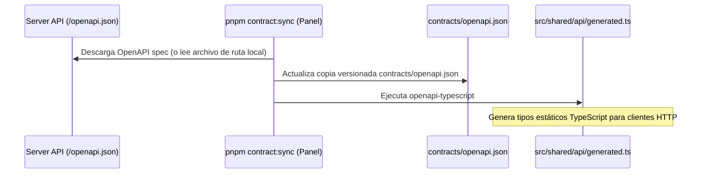

# Contrato de Integración y Sincronización de Tipos — SHALOM Panel

## 1. Principio de Independencia del Contrato

El frontend `panel` es **completamente autónomo**. Para compilar, ejecutar pruebas unitarias y generar builds no necesita el código fuente del backend `server`. 

Toda la comunicación se rige por:
1. El archivo OpenAPI versionado en [`contracts/openapi.json`](file:///contracts/openapi.json).
2. Los eventos de WebSocket documentados para reactividad en tiempo real.

---

## 2. Flujo de Sincronización del Contrato (`pnpm contract:sync`)



- **Variables de sincronización:**
  - `CONTRACT_SOURCE_URL`: URL remota del endpoint de OpenAPI (ejemplo: `http://localhost:3001/openapi.json`).
  - `CONTRACT_SOURCE_FILE`: Ruta alternativa si se sincroniza desde archivo local.

---

## 3. Contrato de Eventos en Tiempo Real (WebSocket / Socket.IO)

El panel se conecta al gateway de WebSocket configurado en `NEXT_PUBLIC_WS_URL` y escucha los siguientes eventos canónicos:

| Evento | Payload | Propósito en el Panel |
| :--- | :--- | :--- |
| `whatsapp:status` | `{ instanceId, status: 'CONNECTED' \| 'DISCONNECTED' \| 'CONNECTING', qrCode?: string }` | Actualiza el indicador visual del header y renderiza el QR de vinculación. |
| `message:new` | `{ conversationId, message: MessageDto }` | Agrega el mensaje entrante al chat activo o incrementa el badge de no leídos. |
| `message:status` | `{ messageId, status: 'SENT' \| 'DELIVERED' \| 'READ' }` | Actualiza los checks de entrega del mensaje. |
| `order:updated` | `{ orderId, orderNumber, newStatusId, previousStatusId }` | Notifica cambios de estado de pedidos en la tabla y kanban. |
| `inventory:alert` | `{ variantId, productName, currentStock, minStock }` | Emite toast de advertencia cuando un producto entra en stock crítico. |

---

## 4. Variables de Entorno del Panel

```env
# URL de la API accesible desde el navegador del cliente
NEXT_PUBLIC_API_URL=http://localhost:3001/api/v1

# URL interna para Server Components dentro de la red Docker
API_INTERNAL_URL=http://server:3001/api/v1

# Gateway de WebSockets para eventos en tiempo real
NEXT_PUBLIC_WS_URL=http://localhost:3001

# Endpoint público para servir imágenes desde MinIO
NEXT_PUBLIC_ASSETS_URL=http://localhost:9000/shalom-assets

# Enlace a la documentación interactiva de la API con Scalar
NEXT_PUBLIC_API_DOCS_URL=http://localhost:3001/docs
```
