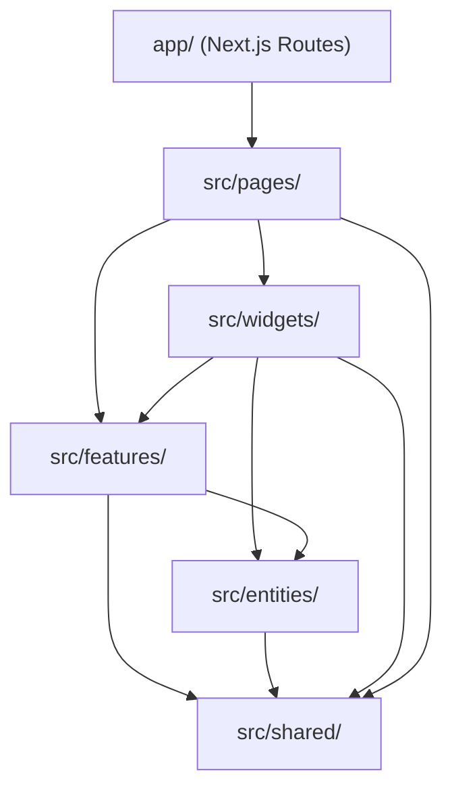

# Arquitectura Frontend — Feature-Sliced Design (FSD) en SHALOM Panel

## 1. Estructura de Capas FSD

El frontend de SHALOM está diseñado con **Feature-Sliced Design (v2.1)** adaptado para **Next.js App Router**. Las capas se ordenan de mayor a menor responsabilidad y nivel de dependencia:

```
app (Next.js App Router)
 └── src/
      ├── app/        Providers, configuración global de temas, error boundaries
      ├── pages/      Composición de páginas completas (vistas desacopladas del router)
      ├── widgets/    Bloques autónomos de UI (Sidebar, Header, WhatsAppInbox, AutomationCanvas)
      ├── features/   Casos de uso del usuario (login, create-order, filter-products, send-message)
      ├── entities/   Conceptos de negocio (product, order, customer, conversation, metric)
      └── shared/     Utilidades agnósticas (api client, ui kit shadcn, hooks, lib, types)
```



---

## 2. Reglas Innegociables de FSD

1. **Jerarquía Unidireccional:** Un módulo solo puede importar de capas estrictamente inferiores.
2. **Prohibición de Imports Cruzados:** Los slices dentro de la misma capa (por ejemplo, `features/create-order` y `features/product-management`) **no pueden importarse entre sí**. Si comparten lógica o UI, esta debe descender a `entities` o `shared`.
3. **API Pública (`index.ts`):** Cada slice expone un único archivo de entrada `index.ts`. Está terminantemente prohibido importar rutas internas de otro slice (ejemplo prohibido: `import ... from '@/features/auth/ui/LoginForm'`).
4. **Desacoplamiento de `shared/ui`:** Los componentes atómicos de UI (botones, inputs, modales, badges) no contienen lógica de negocio ni llamadas a la API.

---

## 3. Resolución del Conflicto Next.js ↔ FSD

Next.js reserva los directorios raíz `app/` y `pages/`. Para evitar colisiones y mantener compatibilidad total:
- La carpeta `panel/app/` en la raíz contiene únicamente **rutas delegadas ultra-finas** (Server Components delgados) que simplemente renderizan la página correspondiente ubicada en `panel/src/pages/*`.
- Se coloca una carpeta vacía `panel/pages/` con un `README.md` explicativo para desactivar el Pages Router legado de Next.js.
- Toda la lógica FSD reside dentro de `panel/src/`.
