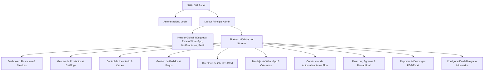

# Mapa de Pantallas y Experiencia de Usuario (UI/UX) — SHALOM Panel

## 1. Identidad Visual y Paleta de Color

Inspirada en flujos limpios de comercio moderno (Dribbble shot `27174303`), optimizada para alto rendimiento y mínima fatiga visual en jornadas operativas extensas.

| Rol Semántico | Código Hexadecimal | Aplicación en la Interfaz |
| :--- | :--- | :--- |
| **Primary Base** | `#0E0E0E` | Fondo dark, texto principal en modo claro, acentos premium. |
| **Surface Light** | `#FBFBFB` | Fondo general de la aplicación, tarjetas y contenedores. |
| **Muted Dark** | `#4C4C4C` | Texto secundario, subtítulos y estados deshabilitados. |
| **Accent Sage** | `#B3C9BF` | Badges suaves, fondos de selección y hover sutil. |
| **Border Slate** | `#717E80` | Líneas divisorias, bordes de inputs y modales. |
| **Deep Olive** | `#3F472F` | Acciones secundarias, botones de marca y encabezados. |
| **Active Green** | `#3A9D24` | Éxito, estado conectado de WhatsApp, ventas y confirmaciones. |

---

## 2. Estructura General de Navegación

---

## 3. Especificación de Pantallas Clave

### 3.1. Bandeja de WhatsApp (Layout de 3 Columnas)
1. **Columna Izquierda (Conversaciones):**
   - Buscador rápido por nombre o teléfono E.164.
   - Pestañas de filtrado: Todas, No leídas, En atención, En bot, Archivadas.
   - Tarjetas de conversación con badge de no leídos, hora del último mensaje y responsable asignado.
2. **Columna Central (Historial y Chat en Tiempo Real):**
   - Encabezado con estado en línea del cliente, nombre y atajo para transferir a bot o humano.
   - Historial de burbujas (cliente a la izquierda, agente a la derecha) con soporte de texto, imágenes, audios y documentos.
   - Barra inferior de envío con atajos a plantillas rápidas y adjuntos.
3. **Columna Derecha (Contexto del Cliente y Pedido Rápido):**
   - Ficha CRM del cliente: Teléfono verificado, dirección principal, total comprado, etiquetas.
   - Botón directo `+ Crear Pedido desde Chat`: Abre un drawer que pre-carga los datos del cliente y permite armar el carrito sin salir de la conversación.
   - Notas internas del equipo sobre la negociación.

### 3.2. Constructor Visual de Automatizaciones (React Flow)
- **Lienzo interactivo:** Nodos arrastrables conectados por aristas dirigidas.
- **Tipos de Nodos:**
  - *Disparadores (Triggers):* Mensaje recibido, pedido creado, cambio de estado, inactividad.
  - *Condiciones:* Cliente nuevo/recurrente, contiene palabra clave, dentro de horario comercial, valor superior a $X.
  - *Acciones:* Enviar mensaje con variables, asignar operador, cambiar etiqueta, solicitar datos.
  - *Control:* Esperar X minutos, finalizar, transferir a humano.
- **Panel de control superior:** Validación de grafo (detección de ciclos en tiempo real), botón Guardar Borrador y Publicar Versión.

### 3.3. Dashboard Financiero (Recharts)
- Tarjetas KPI: Ventas Reconocidas, Ticket Promedio, Ganancia Bruta, Ganancia Neta, COGS, Tasa de Conversión WhatsApp.
- Gráfica interactiva de área/líneas: Comparativa de Ingresos vs. Egresos por día/semana.
- Gráfica de barras horizontales: Top productos más vendidos y su margen de rentabilidad.
- Tabla de alertas de inventario crítico (bajo stock mínimo).
